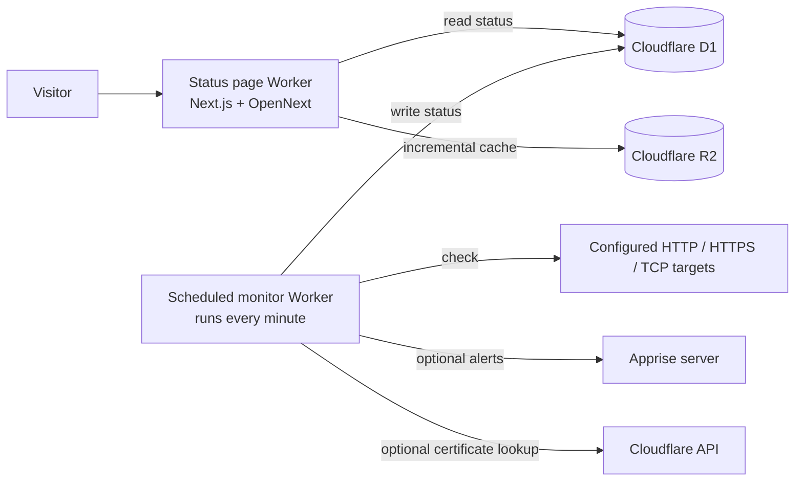

# Uptimeflare Status

Uptimeflare Status is a public status page and service monitor based on [UptimeFlare](https://github.com/lyc8503/UptimeFlare). This fork runs a Next.js application and a scheduled monitoring service as separate Cloudflare Workers, with Cloudflare D1 for status history.

The repository is configured for Cloudflare Workers Builds. It does not currently include a Docker or self-hosted deployment.

## Contents

- [Features](#features)
- [Architecture](#architecture)
- [Requirements](#requirements)
- [Run locally](#run-locally)
- [Configure your status page](#configure-your-status-page)
- [Deploy to Cloudflare](#deploy-to-cloudflare)
- [Status API](#status-api)
- [Security and privacy](#security-and-privacy)
- [Checks and maintenance](#checks-and-maintenance)
- [Contributing and license](#contributing-and-license)

## Features

- Scheduled HTTP, HTTPS, and TCP availability checks.
- Configurable HTTP methods, acceptable response codes, request headers and bodies, timeouts, and response keyword checks.
- Optional TLS certificate-expiration monitoring for HTTPS targets.
- Public status page with service groups, latency charts, maintenance notices, and a JSON endpoint.
- Optional notifications through an Apprise server and custom status-change callbacks.
- D1-backed monitor state shared by the status page and scheduled monitor.
- Optional Umami analytics, disabled unless configured by the deployer.

## Architecture



The two Workers are:

| Worker | Purpose | Configuration |
| --- | --- | --- |
| `uptimeflare` | Serves the Next.js status page and `/api/data` endpoint. | [`wrangler.jsonc`](wrangler.jsonc) |
| `uptimeflare_worker` | Runs the scheduled checks, updates D1, and sends configured notifications. | [`worker/wrangler.toml`](worker/wrangler.toml) |

Both Workers bind to the same D1 database, named `uptimeflare_state` by default. The scheduled Worker runs once per minute. `stateWriteCooldownMinutes` in [`uptime.config.ts`](uptime.config.ts) limits how often unchanged state is written to D1.

## Requirements

- Node.js 22 and npm 10.9.2 (pinned in [`.nvmrc`](.nvmrc) and `package.json`).
- For deployment: a Cloudflare account with Workers, D1, and the R2 bucket configured in Wrangler.
- For local Worker development: Wrangler authentication is only needed for remote Cloudflare operations; local development uses Wrangler's local D1 database.

## Run locally

Install the page dependencies and start the Next.js development server:

```sh
npm ci
npm run start:dev
```

Open `http://localhost:3000`. During Next.js development, the status page and API use [`mock/state.json`](mock/state.json); they do not read the monitor Worker's local D1 database.

To run the scheduled monitor Worker, use a second terminal:

```sh
cd worker
npm ci
npx wrangler d1 migrations apply uptimeflare_state --local --config wrangler-dev.toml
npm run start:dev
```

Wrangler stores local D1 data under the repository's `.wrangler/state` directory. The Worker dev command enables scheduled-event testing; see Wrangler's local development output for how to trigger the scheduled handler.

## Configure your status page

Edit [`uptime.config.ts`](uptime.config.ts). It contains the page presentation, monitor definitions, notifications, callbacks, and maintenance windows.

### Page settings

`pageConfig` supports:

- `title`: the page title.
- `links`: header links with optional highlighting.
- `group`: an ordered mapping of group names to monitor IDs. When groups are configured, monitors omitted from the mapping are hidden from the page but continue to be checked.

### Monitor settings

Each monitor needs a stable `id`, a display `name`, a `method`, and a `target`. Keep an ID unchanged to retain that monitor's history across configuration updates.

| Setting | Purpose |
| --- | --- |
| `method` | An HTTP method such as `GET` or `POST`, or `TCP_PING` for a TCP port check. |
| `target` | The HTTP(S) URL or TCP host and port to check. |
| `expectedCodes` | Accepted HTTP status codes. Defaults to any `2xx` response. |
| `timeout` | Request timeout in milliseconds. Defaults to 10,000 ms. |
| `headers`, `body` | Optional HTTP request headers and body. |
| `responseKeyword` | Require this string in the HTTP response body. |
| `responseForbiddenKeyword` | Mark the check down if this string appears in the response body. |
| `tooltip`, `statusPageLink` | Optional service description and link shown on the page. |
| `hideLatencyChart` | Hide the latency chart for this monitor. |
| `certificateExpiryWarningDays` | Enable certificate status and warn when an HTTPS certificate expires within this many days. |
| `certificateZoneName` | Cloudflare zone name used for the edge-certificate API fallback. |

Use only public, non-sensitive request headers and monitor targets in tracked configuration. See [Security and privacy](#security-and-privacy) before adding credentials or private services.

### Notifications and callbacks

Notifications are disabled in the checked-in configuration. The monitor can send status changes through an Apprise server when both `notification.appriseApiServer` and `notification.recipientUrl` are set. `notification` also supports `timeZone`, `gracePeriod`, and `skipNotificationIds`.

The `callbacks` section provides `onStatusChange` and `onIncident` hooks. They run in the scheduled Worker and can be customized in TypeScript. Avoid logging secrets or sensitive response data from callbacks.

### Maintenance windows

Add entries to the `maintenances` array to show a maintenance notice and suppress notifications for selected monitor IDs. Use ISO 8601 timestamps with an explicit timezone, for example `2026-12-01T02:00:00Z`. An omitted `end` represents an ongoing window.

## Deploy to Cloudflare

The checked-in configuration is for the project maintainer's Cloudflare setup. Before deploying your own copy, review the Wrangler names, custom domain, D1 database name, R2 bucket, monitor targets, and page links. Do not connect your deployment to resources or domains you do not control.

### 1. Create the Cloudflare resources

The Terraform configuration in [`deploy.tf`](deploy.tf) provisions the D1 database only. It reads the Cloudflare API token from `CLOUDFLARE_API_TOKEN` and the account ID from `TF_VAR_CLOUDFLARE_ACCOUNT_ID`; provide these securely in your local environment or approved secret manager, never in a committed `.tfvars` file.

```sh
terraform init
terraform apply
```

Create the R2 bucket named by `bucket_name` in [`wrangler.jsonc`](wrangler.jsonc) before deploying the page Worker. It is used for the OpenNext incremental cache. Cloudflare Workers and a custom domain for the status page must also be available in your account.

### 2. Apply the initial D1 migration

The database must exist before either Worker can use it. The monitor Worker's deploy command applies migrations automatically, but for a first deployment it is safest to apply the initial migration before deploying the page Worker:

```sh
cd worker
npm ci
npm run cf:build
npx wrangler d1 migrations apply uptimeflare_state --remote --config wrangler.toml
cd ..
```

The build helper discovers the D1 UUID by the database name using authenticated Wrangler access, then inserts it into both Wrangler configs for the build. The UUID is an identifier, not a credential, but the helper changes the local config files; keep the checked-in placeholder values and do not commit generated UUID changes.

### 3. Configure Cloudflare Workers Builds

Connect the same GitHub repository to two Cloudflare Workers. Set each Worker name to match the `name` in its Wrangler file and use the production branch `main`.

| Worker | Root directory | Build command | Deploy command |
| --- | --- | --- | --- |
| Status page (`uptimeflare`) | `/` | `npm run cf:build` | `npm run cf:deploy:built` |
| Monitor (`uptimeflare_worker`) | `/worker` | `npm run cf:build` | `npm run cf:deploy:built` |

The page Worker build runs the D1 discovery helper and builds the app with OpenNext for Cloudflare. The monitor Worker build discovers the same D1 database and typechecks its code; its deploy command applies pending D1 migrations and deploys the scheduled Worker.

In Workers Builds branch settings, disable Preview Builds unless you have configured isolated preview resources. The Wrangler configs disable `workers.dev` and preview URLs. The status page uses its configured custom domain; the monitor Worker has no public route. Set build watch paths so changes to shared files such as `uptime.config.ts`, `types/`, `lib/`, and the D1 discovery script trigger the relevant Worker builds.

Workers Builds credentials belong in Cloudflare's build settings. The build identity must be able to discover the D1 database and deploy the configured Worker; the monitor deployment also needs permission to apply D1 migrations. Use the narrowest permissions available for your account.

### 4. Configure optional runtime values

| Name | Where to configure | Purpose |
| --- | --- | --- |
| `CLOUDFLARE_API_TOKEN` | Secret on the `uptimeflare_worker` Worker | Optional fallback for Cloudflare edge-certificate checks when direct TLS inspection is unavailable. Grant read access only to the relevant zone/certificate data. |
| `NEXT_PUBLIC_UMAMI_SCRIPT_URL` | Build variable on the page Worker | Optional Umami script URL. |
| `NEXT_PUBLIC_UMAMI_WEBSITE_ID` | Build variable on the page Worker | Optional Umami site ID. |

The two `NEXT_PUBLIC_UMAMI_*` values are embedded in the browser build and are public configuration, not secrets. Use an analytics property you control. The Worker runtime token is separate from the token used by Workers Builds.

### Deploy manually with Wrangler

After creating the Cloudflare resources and authenticating Wrangler, the same scripts can build and deploy from a local checkout:

```sh
npm ci
npm run cf:build
npm run cf:deploy:built
```

For the monitor Worker, from `worker/`:

```sh
npm ci
npm run cf:build
npm run cf:deploy:built
```

These commands deploy to the Cloudflare account selected by your Wrangler authentication. Verify the account, Worker names, domain, D1 database, and R2 bucket before running them.

### Adapting a fork

Update all related settings together:

- `uptime.config.ts`: monitor targets, page links, page title, grouping, notifications, and maintenance windows.
- `wrangler.jsonc`: page Worker name, custom domain, D1 database name, and R2 bucket.
- `worker/wrangler.toml`: monitor Worker name, D1 database name, and cron schedule.
- `deploy.tf`: D1 database name and account ID input.
- `scripts/set-wrangler-d1-id.mjs` and `worker/package.json`: D1 database name used for discovery and migrations.

The Worker names in Cloudflare must match the Wrangler `name` values. If you rename the D1 database, update every reference listed above.

## Status API

`GET /api/data` returns the current public status as JSON. It includes total up/down counts, an `updatedAt` Unix timestamp in seconds, and per-monitor status, latency, location, and a short message. The response is intentionally public and is sent with `Cache-Control: no-store`.

Example shape:

```json
{
  "up": 3,
  "down": 0,
  "updatedAt": 1790000000,
  "monitors": {
    "service-id": {
      "up": true,
      "latency": 120,
      "location": "DFW",
      "message": "OK"
    }
  }
}
```

`latency` is measured in milliseconds. `location` is the Cloudflare data-center code that performed the check.

## Security and privacy

This is a public repository. Treat every tracked value, build log, and generated browser asset as public.

- Do not commit API tokens, passwords, credential-bearing notification URLs, private endpoints, or sensitive headers and request bodies.
- The current Apprise settings and custom monitor headers/bodies are read from tracked TypeScript configuration. Do not use them for credentials; moving those values to Worker secrets requires a code change.
- `CLOUDFLARE_API_TOKEN` is a runtime secret for the monitor Worker and must be configured as a Cloudflare Worker secret, not placed in `uptime.config.ts`.
- The page is public by default. A Basic Authentication hook exists in [`middleware.ts`](middleware.ts), but it is disabled by default and reads its credential from source configuration. Do not enable it with a real password until it is changed to use a runtime secret.
- Public status information includes configured service names, availability, latency, and check messages. Configure only information you intend visitors to see.

For vulnerability reporting, follow [SECURITY.md](SECURITY.md). For community behavior, see [CODE_OF_CONDUCT.md](CODE_OF_CONDUCT.md).

## Checks and maintenance

Install dependencies and run the project checks:

```sh
npm ci
npm ci --prefix worker
npm run test
npm run coverage:unit
npm --prefix worker run typecheck
```

`npm run test` runs unit and end-to-end tests. `npm run coverage:unit` runs the unit suite with its coverage gate. GitHub Actions runs tests, coverage, and the monitor Worker typecheck on pushes and pull requests; Codecov uploads coverage for eligible runs.

GitHub Actions validates changes; Cloudflare Workers Builds performs deployments. The test workflow does not deploy Workers.

### Troubleshooting deployments

| Symptom | Check |
| --- | --- |
| D1 database discovery fails | Confirm Wrangler is authenticated, its build token can list D1 databases, and exactly one database has the configured name. |
| The page reports no status data or D1 errors | Confirm the initial migration has been applied and both Workers bind to the same D1 database. Check that the scheduled monitor Worker deployed and its cron trigger is active. |
| The page Worker build or deploy cannot bind the cache | Confirm the R2 bucket exists and its name matches `bucket_name` in `wrangler.jsonc`. |
| Cloudflare reports a Worker name mismatch | Make the Worker name in the dashboard match the `name` in that Worker's Wrangler config. |
| A certificate status is unavailable | Check the HTTPS target and `certificateZoneName`. If direct TLS inspection is unavailable, configure the optional `CLOUDFLARE_API_TOKEN` Worker secret with read access to the zone certificate data. |

For formatting and lint fixes, see [CONTRIBUTING.md](CONTRIBUTING.md). These commands modify files in place.

## Contributing and license

Read [CONTRIBUTING.md](CONTRIBUTING.md) before opening a pull request and follow the [Code of Conduct](CODE_OF_CONDUCT.md). Project changes are recorded in [CHANGELOG.md](CHANGELOG.md). This project is licensed under the [GNU General Public License v3.0](LICENSE.txt).
